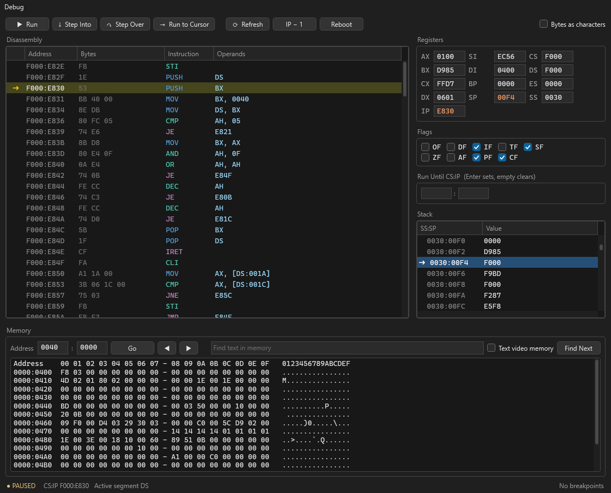

# x8086NetEmu

A cycle-scheduled 8088/8086/80186 PC emulator written in VB.NET. It boots real ROMs, no BIOS hacks required.


## Features

- **CPU:** 8086/8088 with V20/80186 extensions, validated against the [8088 ProcessorTests](https://github.com/TomHarte/ProcessorTests/tree/main/8088). The clock is configurable from 4.77 MHz up, and peripherals keep their real rates.
- **Chipset:** 8259 PIC, 8254 PIT, 8237 DMA, 8255 PPI.
- **Video:** CGA, and a register-level VGA running a real VGA BIOS (standard VGA modes).
- **Sound:** PC speaker, AdLib (OPL2) and Sound Blaster 2.0.
- **Input:** keyboard, plus a Microsoft serial mouse on COM1.
- **Storage:** floppy and hard disk images. The Disk Explorer (FAT12/FAT16) supports drag & drop to and from the host.
- **Tools:** debugger, log console, and text copy/paste in any video mode.



## Building and running

Install [Git](https://git-scm.com/downloads) and the [.NET 10 SDK](https://dotnet.microsoft.com/download), then get the source:

```
git clone https://github.com/morphx666/x8086NetEmu.git
cd x8086NetEmu
```

Then run the command for your OS.

### Windows

```
dotnet run --project Eto.Forms/x8086NetEmuEto.Wpf
```

### Linux

Requires GTK 3, which most desktop distributions already include.

```
dotnet run --project Eto.Forms/x8086NetEmuEto.Gtk
```

### macOS

```
dotnet run --project Eto.Forms/x8086NetEmuEto.Mac
```

ROMs, disk images and `settings.dat` live in the `Release` folder.

Precompiled binaries are available in [releases](https://github.com/morphx666/x8086NetEmu/releases).

| Keys | Action |
|---|---|
| Shift+Alt+Home | Emulator menu (RCtrl+Home in WinForms) |
| Shift+Alt+C / Shift+Alt+V | Copy / paste text |

The mouse is captured while the pointer is over the emulator. To release it, push the pointer firmly past any corner of the display, or open the menu.

## Frontends

The cross-platform [Eto.Forms](https://github.com/picoe/Eto) frontends are the main ones: `x8086NetEmuEto.Wpf` (Windows), `.Gtk` (Linux) and `.Mac` (macOS).

The solution also still includes:

- the legacy WinForms frontend, which has an experimental [browser UI](https://github.com/morphx666/x8086NetEmu/commit/c08b69b7c6ffbe165a036b811ff8e2b71e529854) at http://localhost:8086
- a Console frontend, configured by editing `settings.dat`

## Credits

- [@TomHarte](https://github.com/TomHarte/ProcessorTests/tree/main/8088)'s ProcessorTests exposed a `TEST` (0x84) bug that had broken EDIT, QBASIC, DEFRAG and Windows.
- Parts of the code were adapted from [PCE](http://www.hampa.ch/pce/): Group 2, DIV/IDIV/MUL/IMUL and flags.
- Parts were adapted from [retro](http://jorisvr.nl/article/retro): the scheduler, chipset and keyboard.
- Sound uses [BASS](http://www.un4seen.com/) through ManagedBass.
